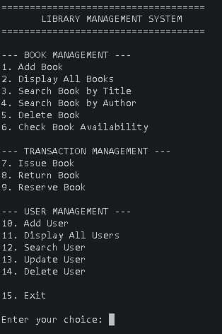
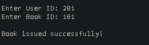
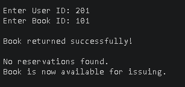
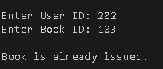

# Library Management System

A console-based **Library Management System built with C++17**. This academic project demonstrates how common Data Structures and Algorithms can be applied to book management, user records, book circulation, and reservations.

## Project Overview

The system allows a librarian to manage a collection of books and registered users through a menu-driven interface. It supports issuing and returning books, queuing reservation requests, and saving records to local text files so that data can be loaded again when the application restarts.

## Key Features

- **Book management:** Add, display, search by title or author, check availability, and delete eligible books.
- **User management:** Register, display, search, update, and delete user records.
- **Book circulation:** Issue books to registered users and validate returns against the borrower.
- **Reservations:** Queue requests for issued books and process them in FIFO order when a book is returned.
- **File persistence:** Load and save book and user records using text files.

## Screenshots

### Main Menu


### Book List


### Issue Book


### Return Book


### Reservation Validation


In this example, User ID `202` attempts to reserve Book ID `103`, which is already issued. The system displays **"Book is already issued!"**.

## Technologies and Concepts

| Area | Technology / Concept |
|---|---|
| Programming language | C++ |
| Language standard | C++17 |
| Compiler | GCC / g++ |
| Development environment | Visual Studio Code |
| User records | Array |
| Book records | Singly linked list |
| Reservation requests | Queue (FIFO) |
| Data persistence | File handling with text files |

## Data Structures Used

| Data Structure | Purpose |
|---|---|
| Array | Stores user records (maximum capacity: 100 users) |
| Singly Linked List | Stores and manages book records |
| Queue | Maintains reservation requests in First-In, First-Out order |
| File Streams | Saves and loads records between program runs |

## Project Structure

```text
Library_Management/
├── include/
│   ├── Book.h
│   └── User.h
├── src/
│   ├── main.cpp
│   ├── Book.cpp
│   └── User.cpp
├── data/
│   ├── books.txt
│   └── users.txt
├── screenshots/
│   ├── main_menu.png
│   ├── book_list.png
│   ├── issue_book.png
│   ├── return_book.png
│   └── reservation-already-issued.png
├── docs/
├── Library_Management_System.docx
└── .gitignore
```

## Requirements

- Windows, Linux, or macOS
- GCC with C++17 support (or another compatible C++17 compiler)
- Visual Studio Code or another C++ editor (optional)

## Build and Run

Run the commands from the project root directory.

### Windows (PowerShell)

Compile:

```powershell
g++ -std=c++17 -Wall -Wextra -I include src/main.cpp src/Book.cpp src/User.cpp -o LibraryManagement.exe
```

Run:

```powershell
.\LibraryManagement.exe
```

### Linux / macOS

Compile:

```bash
g++ -std=c++17 -Wall -Wextra -I include src/main.cpp src/Book.cpp src/User.cpp -o LibraryManagement
```

Run:

```bash
./LibraryManagement
```

**Important:** Run the executable from the project root directory. The `data` directory must exist so the application can read and write `books.txt` and `users.txt`.

## Testing

The project has been manually tested for core operations and common invalid cases, including duplicate IDs, invalid IDs, unavailable books, incorrect return users, deletion restrictions, duplicate reservations, FIFO reservation assignment, and loading saved records after restarting the application.

## Documentation

The repository includes the project report: [Library_Management_System.docx](Library_Management_System.docx).

## Future Enhancements

- Replace text-file storage with SQLite or MySQL
- Add login and role-based access
- Add due dates, overdue tracking, and fine calculation
- Develop a graphical or web-based interface
- Add backups and stronger file validation

## Author

**Aditya Patel**

Academic MCA project focused on C++ and Data Structures and Algorithms.
